# JiecUnit

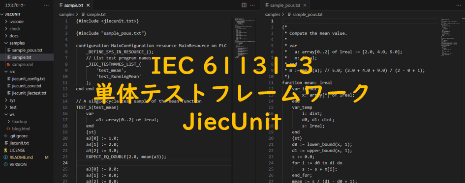

## 目次
- [概要](#概要)
- [テストの書き方](#テストの書き方)
  - [最小の例](#最小の例)
  - [テストの種類](#テストの種類)
  - [アサーション](#アサーション)
  - [失敗の出力](#失敗の出力)
  - [サイクル数の上限](#サイクル数の上限)
  - [実行結果の変数と再実行（PLC）](#実行結果の変数と再実行plc)
  - [設定の上書き](#設定の上書き)
  - [JUnit XML](#junit-xml)
  - [Google Test との違い](#google-test-との違い)
  - [7.x からの移行](#7x-からの移行)
- [アサーションのメッセージ引数](#アサーションのメッセージ引数)
- [必要環境](#必要環境)
- [単体テストのサンプルの実行方法](#単体テストのサンプルの実行方法)
  - [オムロン社製Sysmac Studioの場合](#オムロン社製sysmac-studioの場合の単体テストサンプルの実行方法)
  - [キーエンス社製KV Studioの場合](#キーエンス社製kv-studioの場合の単体テストサンプルの実行方法)
  - [CODESYS社製CODESYSの場合](#codesys社製codesysの場合の単体テストサンプルの実行方法)
- [JiecUnit開発者向け](#jiecunit開発者向け)
  - [リポジトリ構成](#リポジトリ構成)
  - [JiecUnitのテスト方法](#jiecunitのテスト方法)
  - [ターゲットごとのアサーションの対応](#ターゲットごとのアサーションの対応)
  - [各メーカーの言語サポート状況](#各メーカーのiec-61131-3言語サポート状況)
- [ライセンス](#ライセンス)
- [その他の情報](#その他の情報)

## 概要

JiecUnitは、テキスト形式で記述された[IEC 61131-3言語](https://plcopen.org/sites/default/files/downloads/iec_61131-3_preview.pdf)のPOUを単体テストするためのフレームワークです。

特徴は、テスト対象POUのソースコード、単体テストコード、JiecUnit自体のソースコードがすべてIEC 61131-3 ST言語を拡張したテキスト形式で完結している点です。これにより、Git等で直接構成管理が可能です。[Visual Studio Code](https://code.visualstudio.com/)などの対応IDEによっては生成AIを活用したIEC 61131-3プログラミングも可能です。

このテキスト形式コードをPLCメーカーのツールで取り込み可能な形式に変換するため、[IEC 61131-3 ⇄ IEC 61131-10変換ソフトウェア Jiecc](https://www.graviness.com/iec_61131-3/jiecc.html)を使用します。

JiecUnitは現在、[IEC 61131-10 XML](https://plcopen.org/sites/default/files/downloads/iec_61131-10_preview.pdf)をサポートする以下の環境に対応しています。
* オムロン社製[Sysmac Studio](https://www.fa.omron.co.jp/products/family/3077/download/software.html)
* キーエンス社製[KV Studio](https://www.keyence.co.jp/support/user/controls/installer/)
* CODESYS社製[CODESYS](https://content.helpme-codesys.com/en/CODESYS%20Installer/_inst_start_page.html)
* Jieccのjierインタプリタによる直接実行（`jiecc --run`。PLC・IDE不要。開発者検証／CI用途）

## テストの書き方

### 最小の例

```
{#include <jiecunit.iec>}

TEST_S(test_add)                       // 単一サイクルのテスト（プログラム test_add）
	EXPECT_EQ_INT(4, add(2, 2));
END_TEST_S

TEST_M(test_counter)                   // 複数サイクルのテスト。EOT() で終える
	var
		ctu_instance: ctu;
	end
	ctu_instance(cu := (CURRENT_CYCLE() mod 2) = 0, pv := 3);
	if CURRENT_CYCLE() = 5 then
		EXPECT_TRUE(ctu_instance.q);
		EOT();
	end_if;
END_TEST_M

// テストのプログラム名を、すべての定義の後ろに 1 回だけ並べる
DEFINE_CONFIGURATION(
	_JIEC_TESTNAMES_LIST_(
		test_add,
		test_counter
	)
)
```

* `DEFINE_CONFIGURATION(_JIEC_TESTNAMES_LIST_(...))` は、すべてのテストの定義の**後ろ**に 1 回だけ書きます。前処理の時点でテストの定義の数と一覧の名前の数を比べ、書き忘れがあればエラー（`PP91: JiecUnit: the number of TEST_S/TEST_M definitions differs ...`）で止めます。照合を止めるには `JIECUNIT_NO_TEST_COUNT_CHECK` を定義します。
* PLC では、`JiecUnitMain` と各テストプログラム（一覧に書いた名前のプログラム。スイートなら `suite_name`、フィクスチャなら `F_name`）を**同じタスク**に割り付け、`JiecUnitMain` を先頭（または末尾）に置きます。ヘルパーや `F_SetUp` / `F_TearDown` は関数なので、割り付けません。テストプログラムが JiecUnitMain の 1 サイクルの間に実行されなかったり、2 回以上実行されたりすると `[  ERROR ]` になります。

### テストの種類

| 書き方 | 意味 |
|---|---|
| `TEST_S(name)` … `END_TEST_S` | 単一サイクルのテスト。`END_TEST_S` か、本体の `return` で終わります。 |
| `TEST_M(name)` … `END_TEST_M` | 複数サイクルのテスト。`EOT()` で終わります。`CURRENT_CYCLE()` で何サイクル目か（0 から）が分かります。 |
| `TEST_S(suite, name)` / `TEST_M(suite, name)` | スイートに属するテスト。プログラム名は `suite_name`（一覧にはこの名前を書く）、結果の表示は `suite.name` です。 |
| `TEST_F_S(F, name)` / `TEST_F_M(F, name)` | フィクスチャ `F` を使うテスト（Google Test の `TEST_F`）。終わりは `END_TEST_S` / `END_TEST_M` です。 |
| `EOT()` | テストを終えます。 |
| `SKIP_TEST(reason)` | テストをスキップとして終えます。Google Test と同じく `file:line: Skipped` と理由の 2 行を出します。失敗の後にスキップしたテストは `[ FAILED ]` です。 |
| `JIECUNIT_LOG(text)` | テストやヘルパーから 1 行出力します（失敗にはなりません）。 |
| `SET_TEST_MAX_CYCLES(n)` | そのテストのサイクル数の上限を変えます（下記）。 |

* KEYENCE では、プログラム名（`suite_name` / `F_name` を含む）を 64 バイト以内にしてください。

#### フィクスチャ

```
type
	TankFixture: struct           // フィクスチャのデータ。テストのたびにクリアされる
		level: dint;
	end
end

function TankFixture_SetUp        // 本体の前に呼ばれる
	JIECUNIT_DECLARE_HELPER();
	var_in_out fixture: TankFixture; end
	fixture.level := 10;
end

function TankFixture_TearDown     // テストが終わった後に必ず呼ばれる
	JIECUNIT_DECLARE_HELPER();
	var_in_out fixture: TankFixture; end
	EXPECT_LE_INT(fixture.level, 100);
end

TEST_F_S(TankFixture, fills)      // プログラム TankFixture_fills、表示 TankFixture.fills
	fixture.level := fixture.level + 5;
	EXPECT_EQ_INT(15, fixture.level);
END_TEST_S
```

* テストは変数 `fixture` を使えます。テストを実行するたびに、`fixture` をクリアしてから `F_SetUp` を呼びます。
* フィクスチャの初期値は、`F_SetUp` で代入してください。構造体のメンバーに書いた初期値（`level: dint := 1;`）には頼らないでください。OMRON の構造体定義にはメンバーの初期値が無く、0 や空文字列になります（メンバーの初期値がある環境では、クリアした後の値はその初期値です）。
* `F_SetUp` が致命的に失敗するか、`SKIP_TEST`・`EOT()` で終えたときは、本体を実行しません。
* `F_TearDown` は、テストが `EOT()`・`ASSERT`・`SKIP_TEST`・サイクルの上限のどれで終わっても、JiecUnitMain が 1 サイクル待つ間に実行されます。TearDown の失敗もそのテストに数えます。
* フィクスチャの型は、関数の `var_in_out` に渡せる型（構造体）にしてください。
* `F_SetUp` と `F_TearDown` は、何もしない場合も両方とも定義してください（無いと未定義の関数になります）。

### アサーション

`EXPECT_*` は失敗を記録してテストを続け、`ASSERT_*` は失敗を記録してテストを終えます（ヘルパーの中では、ヘルパーから戻るだけです。下記）。どれも末尾に省略可能なメッセージを渡せます。

| アサーション | 内容 |
|---|---|
| `EXPECT_TRUE(c)` / `EXPECT_FALSE(c)` | 条件が真／偽 |
| `EXPECT_EQ_<T>(expected, actual)` / `EXPECT_NE_<T>` | 等しい／等しくない |
| `EXPECT_LT_<T>(a, b)` / `LE` / `GE` / `GT` | 大小 |
| `EXPECT_NEAR(a, b, abs_error)` | 差の絶対値が `abs_error` 以下 |
| `EXPECT_NEAR_REL(a, b, rel_error)` | 差の絶対値が `rel_error * max(abs(a), abs(b))` 以下 |
| `EXPECT_DOUBLE_EQ(a, b)` / `EXPECT_FLOAT_EQ(a, b)` | LREAL／REAL として 4 ULP 以内（Google Test と同じ） |
| `EXPECT_EQ_ARRAY_<T>(expected, actual, n)` | 配列の添字 0 から n - 1 が等しい。最初に違う要素を報告します |
| `EXPECT_NEAR_ARRAY(expected, actual, n, abs_error)` | 配列の各要素が `EXPECT_NEAR` を満たす |
| `EXPECT_FLOAT_EQ_ARRAY(expected, actual, n)` / `EXPECT_DOUBLE_EQ_ARRAY(expected, actual, n)` | REAL／LREAL の配列の各要素が 4 ULP 以内 |
| `EXPECT_STR_CONTAINS(s, sub)` | 文字列 `s` が `sub` を含む |
| `FAIL()` / `ADD_FAILURE()` | 失敗を記録する（`FAIL` はテストを終える） |
| `EXPECT_NO_FATAL_FAILURE(stmt)` / `ASSERT_NO_FATAL_FAILURE(stmt)` | 文が新しい致命的な失敗を起こさない |
| `SCOPED_TRACE(text, stmt)` | 文を実行し、その間の失敗に `text` とこの行の位置を添える（下記） |
| `EXPECT_FATAL_FAILURE(stmt, sub)` / `EXPECT_NONFATAL_FAILURE(stmt, sub)` | 文がその種類の失敗をちょうど 1 つ起こし、その出力（位置の行を除く）のどれかの行が `sub` を含む（アサーションやヘルパー自体のテスト用。確かめた失敗は表示も集計もしません） |
| `HAS_FATAL_FAILURE()` / `HAS_NONFATAL_FAILURE()` / `HAS_FAILURE()` | 実行中のテストに失敗があったか |

* 表の `EXPECT_` で始まるものは、`EXPECT_FATAL_FAILURE` / `EXPECT_NONFATAL_FAILURE` を除き、`ASSERT_` でも書けます（`FAIL` / `ADD_FAILURE` / `HAS_*` は表のとおりです）。ターゲットごとに使える型は、[ターゲットごとのアサーションの対応](#ターゲットごとのアサーションの対応)を参照してください。
* `<T>` は `SINT` `INT` `DINT` `LINT` `USINT` `UINT` `UDINT` `ULINT` `INT32` `INT64` `UINT32` `UINT64` `REAL` `FLOAT` `LREAL` `DOUBLE` `BOOL` `BYTE` `WORD` `DWORD` `LWORD` `BIT32` `BIT64` `TIME` `DATE` `TOD` `DT` `STRING` です。整数とビット列は 32bit か 64bit の型に広げて比べます。`REAL` / `FLOAT` は REAL のまま、`LREAL` / `DOUBLE` は LREAL で比べます（どちらも厳密な比較です。丸め誤差を許すときは `EXPECT_FLOAT_EQ` / `EXPECT_DOUBLE_EQ` か `EXPECT_NEAR` を使います）。
* `TIME` の値は、時間リテラルの形（`T#1h30m5s250ms`、1 ms 未満は `T#250.123456ms` のように小数）で表示します。
* `EXPECT_EQ_ARRAY_<T>` の配列は添字 0 から始まる必要があり、`n` は配列の長さ以下にします。`n` と配列の式は何度も評価されるので、副作用のない式にしてください。

#### ヘルパー

テストの外の POU（関数・FB・プログラム）でアサーションを使うときは、その POU の宣言に `JIECUNIT_DECLARE_HELPER();` を書きます。

```
function check_in_range: bool
	JIECUNIT_DECLARE_HELPER();
	var_input value: dint; end
	ASSERT_GE_INT(value, 0);
	ASSERT_LE_INT(value, 100);
	check_in_range := true;
end

TEST_S(test_values)
	var ok: bool; end
	ASSERT_NO_FATAL_FAILURE(ok := check_in_range(50));   // ヘルパーが致命的に失敗したら、ここでテストを終える
	EXPECT_NO_FATAL_FAILURE(ok := check_in_range(150));  // 失敗を記録して続ける
END_TEST_S
```

* Google Test と同じく、ヘルパーの中の `ASSERT_*`・`FAIL` はヘルパーから戻るだけで、テストは続きます。`HAS_FATAL_FAILURE()` で分かり、`ASSERT_NO_FATAL_FAILURE` でテストを終えられます。
* `JIECUNIT_DECLARE_HELPER()` を書き忘れると、`g_jiectest` か `jiecunit_in_helper` が未宣言（`UNDEFINED_SYMBOL`）というエラーになります。
* 同じヘルパーを何度も呼ぶと、失敗がどの呼び出しのものか分かりません。`SCOPED_TRACE(text, stmt)` で呼び出しを包むと、その間の失敗の後ろに `JiecUnit trace:` と `file:line: text` の行が付きます（入れ子にすると内側から順に並びます。深さは 8 まで）。`text` は実行時に組み立てられます。

  ```
  for value_index := 0 to 2 do
  	SCOPED_TRACE(jiec_concat('value_index ', dint_to_string(value_index)), ok := check_in_range(values[value_index]));
  end_for;
  ```

  Google Test の `SCOPED_TRACE` はスコープの終わりまで有効ですが、ST にはその仕組みが無いので、対象の文を引数に書きます。文はヘルパーの呼び出しにしてください。文が POU から戻ると（文に直接 `ASSERT_*` を書いた場合や、ヘルパーの中で `SCOPED_TRACE(text, ASSERT_NO_FATAL_FAILURE(...))` と書いた場合）、そのサイクルの終わりまでトレースが残り、後の無関係な失敗にも付きます。`ASSERT_NO_FATAL_FAILURE` と組み合わせるときは、`ASSERT_NO_FATAL_FAILURE(SCOPED_TRACE(text, ok := helper()))` と外側に書きます。`text` は `EXPRESSION_MAX_SIZE`（既定 128）文字までです。
* 値をメッセージや `JIECUNIT_LOG` に入れるときは、`jiec_concat('level=', dint_to_string(level))` のように組み立てます。
* ヘルパーの中で `EOT()` や `SKIP_TEST` を呼ぶと、テストはその時点で終わったものとされ、ヘルパーから戻ります。呼び出し側の本体は、そのサイクルの残りを実行します（Google Test の `GTEST_SKIP` は、ヘルパーから戻るだけです）。

### 失敗の出力

次は、上のフィクスチャの例で、本体の `EXPECT_EQ_INT(15, fixture.level)` を `EXPECT_EQ_INT(16, fixture.level, 'level after filling')` に変えて、tank_test.iec の 42 行目に書いたときの出力です。

```
[ RUN    ] TankFixture.fills
tank_test.iec:42: Failure
Expected equality of these values:
  16
  fixture.level
    Which is: 15
level after filling
[ FAILED ] TankFixture.fills (n/a)
```

* 位置は `<ファイル>:<行>: Failure` で、複数サイクルのテストでは ` (cycle N)` が付きます。ファイルは jiecc に渡した（またはインクルードに書いた）パス、行は jiecc で変換する前のテキストの行です。
* 式のテキストと値を出します。値がリテラルと同じ表示なら `Which is:` を省きます。不等と大小は `Expected: (a) < (b), actual: 3 vs 2`、`EXPECT_TRUE` は `Value of: c` / `  Actual: false` / `Expected: true` と出します。
* STRING の値は `'...'` で囲み、`'` と `$` を `$'`・`$$` と書きます。REAL の値は、LREAL に広げた正確な値で出します（例: `0.10000000149011612`）。
* ファイル名は jiecc に渡したパスがそのまま入るので、jiecc は相対パス（例: `jiecc samples/sample.iec ...`）で呼んでください。ファイル名は `FILENAME_MAX_SIZE`（既定 128）文字までです。
* 式のテキストの長さは `EXPRESSION_MAX_SIZE`（既定 128）文字までです。jier は長いファイル名や式も切らずに出しますが、PLC で長さを超えたときに切れるかビルドエラーになるかは、ベンダーによります。PLC のメモリやスキャン時間を減らしたいとき、または長い式が文字列の長さの制限に掛かるときは、`JIECUNIT_NO_EXPRESSION_TEXT` を定義すると、式のテキストを渡さず値だけを出します。
* 所要時間は、時計のあるターゲット（OMRON・KEYENCE）では `(123us)`、それ以外（jier・CODESYS・三菱）では `(n/a)` です。
* コンソール（`g_console`）の行バッファ（`CONSOLE_MAX_ROWS` 行）が一巡したときは、最後に `[ WARNING] The console buffer is full ...` と出します。古い行が上書きされている可能性があります。

### サイクル数の上限

`EOT()` を呼ばない `TEST_M` は、`JIECUNIT_MAX_CYCLES_PER_TEST` サイクル（既定 100000。jier では 1000）実行しても終わらなければ失敗として記録され、次のテストへ進みます。`SET_TEST_MAX_CYCLES(n)` でそのテストだけ上限を変えられます（0 以下で無制限）。`TEST_S` は最初のサイクルの終わりで必ず終わります。

### 実行結果の変数と再実行（PLC）

`_JIEC_TESTNAMES_LIST_` は、次のグローバル変数も宣言します。PLC のツールで読み書きできます。

| 変数 | 内容 |
|---|---|
| `g_jiecunit_result.state` | 0: 未実行、1: 実行中、2: 完了 |
| `g_jiecunit_result.num_of_tests` / `num_of_passed` / `num_of_failed` / `num_of_skipped` | テストの数（テストが終わるたびに更新） |
| `g_jiecunit_result.all_passed` | 完了して失敗が無いとき true |
| `g_jiecunit_result.elapsed_us` / `run_count` | 所要時間（us）／実行した回数 |
| `g_jiecunit_rerun` | 完了した後に true にすると、すべてのテストをもう一度実行します（実行中に立てた要求は捨てます） |

* 既定では、PLC を運転にするとすぐにテストを始めます。`JIECUNIT_MANUAL_START` を定義する（`-D JIECUNIT_MANUAL_START`）と、`g_jiecunit_rerun` を true にするまで何も実行しません（その間、`g_jiecunit_result.state` は 0 です）。

* 再実行では、テストプログラムの変数は初期化されません（PLC のプログラムは、ダウンロードし直すまで初期化されないため）。テストごとに初期化したい状態はフィクスチャに置いてください。
* ほかの POU から参照するときは `DECLARE_EXTERNAL_JIECUNIT_RESULT();` で `var_external` を宣言できます。
* jier（`jiecc --run`）は、集計の後に `halt` で止まり、終了コードが結果を表します（合格 0、失敗 1）。`JIECUNIT_NO_HALT` を定義すると止まらず、PLC と同じく動き続けます。

### 設定の上書き

次の値は `-D NAME=VALUE`（`jiecc -D MAX_TESTS=64 ...`）で変えられます。

| 名前 | 既定値 | 内容 |
|---|---|---|
| `MAX_TESTS` | 512（上限 512） | テストの数の上限 |
| `TESTNAME_MAX_SIZE` / `FILENAME_MAX_SIZE` | 128 | テスト名／ファイル名の長さ |
| `EXPRESSION_MAX_SIZE` | 128 | 失敗に出す式のテキストの長さ |
| `JIECUNIT_MAX_CYCLES_PER_TEST` | 100000（jier 1000） | テストのサイクル数の上限 |
| `JIECUNIT_MAX_NO_FATAL_FAILURE_DEPTH` | 8 | `*_NO_FATAL_FAILURE` の入れ子の深さ |
| `JIECUNIT_MAX_TRACE_DEPTH` | 8 | `SCOPED_TRACE` の入れ子の深さ |
| `STRING_MAX_SIZE` | ターゲットごと（255〜1986） | 文字列の長さ |
| `CONSOLE_MAX_ROWS` / `CONSOLE_MAX_COLS` | 1024 / ターゲットごと | コンソールの行数／1 行の長さ |
| `JIECUNIT_NO_EXPRESSION_TEXT` | （未定義） | 定義すると、失敗に式のテキストを出さない |
| `JIECUNIT_NO_TEST_COUNT_CHECK` | （未定義） | 定義すると、テストの数と一覧の照合をしない |
| `JIECUNIT_NO_HALT` | （未定義） | 定義すると、jier でも集計の後に止まらない |
| `JIECUNIT_MANUAL_START` | （未定義） | 定義すると、`g_jiecunit_rerun` を true にするまでテストを始めない |

小さい PLC では、`MAX_TESTS` と `CONSOLE_MAX_ROWS` を小さくするとメモリを減らせます。`MAX_TESTS` を一覧のテストの数より小さくすると、前処理のエラーになります。

### JUnit XML

`scripts/jiecunit_to_junit.py` で、JiecUnit の出力を JUnit XML に変換できます。CI のテスト結果の表示に使えます。

```
$ jiecc --run test/test.iec -I. -I./sys > output.txt
$ python scripts/jiecunit_to_junit.py output.txt -o result.xml
$ python scripts/run_tests.py --run-only --junit-dir build/junit   # スイートごとに書く
```

再実行した出力は、最後の実行だけを変換します。実行が途中で切れている、結果の無いテストがある、集計の行（`[ PASSED ]`・`[ SKIPPED]`・`[ FAILED ]` の数）と読み取った結果が合わない、コンソールの警告があるなどの問題は、XML に `(run)` という名前のエラーとして加え、終了コード 1 を返します。

PLC の `g_console` の行を古い順に書き出したテキストも変換できます。`suite.name` のテストは `classname` が `suite` になります。

### Google Test との違い

* ST にはクロージャや例外が無いため、フィクスチャは「構造体＋`F_SetUp`/`F_TearDown` 関数」の規約で、TearDown はテストが終わった次のサイクルで実行します。
* テストの登録は自動ではありません。一覧（`_JIEC_TESTNAMES_LIST_`）に書き、数の照合で書き忘れを検出します（jiepp はマクロからディレクティブを作れず、構成とタスク割付にプログラム名が要るため）。
* `EXPECT_FLOAT_EQ` / `EXPECT_DOUBLE_EQ` は、無限大を同じ無限大とだけ等しいとします（Google Test は最大の有限値と無限大を 1 ULP 離れているとみなします）。
* REAL の値は 9 桁ではなく、LREAL に広げた正確な値で表示します。
* `EXPECT_DOUBLE_EQ`（4 ULP 以内）と `EXPECT_EQ_DOUBLE`（厳密な比較）は、語順が違うだけで意味が違います（`EXPECT_EQ_<T>` の形は JiecUnit の型ごとのマクロです）。
* `EXPECT_FATAL_FAILURE` / `EXPECT_NONFATAL_FAILURE` の `sub` は、失敗の出力の 1 行ずつと照合します（Google Test は全文と照合します）。
* `EXPECT_FATAL_FAILURE` の文は、ヘルパーの呼び出しにしてください（文に直接 `ASSERT_*` を書くとテストから戻ってしまい、次のサイクルの始めにその旨の失敗になります）。
* 結果の行の見出しは 8 文字幅（`[ RUN    ]`、`[     OK ]`、`[========]`）で、Google Test の 10 文字幅（`[ RUN      ]`）と違います。集計の文面も違います（`[ FAILED ] N tests, listed below.`）。Google Test の出力用の正規表現は、そのままでは合いません。
* `SCOPED_TRACE(text, stmt)` は、対象の文を引数に取ります（Google Test はスコープの終わりまで有効です）。見出しは `Google Test trace:` ではなく `JiecUnit trace:` です。
* `EXPECT_NEAR_REL`（相対誤差）は JiecUnit のアサーションで、Google Test にはありません。無限大は、同じ無限大のほかには近いとみなしません。
* フィルタ、`DISABLED_`、シャッフル、繰り返し、パラメータ化テスト、モックはありません。

### 7.x からの移行

* `DEFINE_CONFIGURATION(_JIEC_TESTNAMES_LIST_(...))` を、すべてのテストの定義の後ろへ移してください。
* `EXPECT_EQ_REAL` などの `*_REAL` / `*_FLOAT` に LREAL の値を渡しているところは、`*_LREAL` / `*_DOUBLE` か `EXPECT_DOUBLE_EQ` に変えてください（REAL のまま比べるようになりました。ベンダーによっては、LREAL を渡しても黙って REAL に丸めて比べます）。
* テストの外でアサーションを使っている POU には、`JIECUNIT_DECLARE_HELPER();` を書いてください。
* 構成を手で書いている場合は、`g_jiecunit_result: JiecUnitResult_t;` と `g_jiecunit_rerun: bool;` をグローバル変数に加えてください。
* 失敗の出力の形式が変わりました。出力を解析しているツールは、上の「失敗の出力」に合わせてください。検証関数（`JiecTest_validate*`）を位置引数で呼んでいるときは、式のテキストの引数を加えてください。

## アサーションのメッセージ引数

すべての`EXPECT_*`・`ASSERT_*`アサーションマクロ（`EXPECT_FATAL_FAILURE`・`EXPECT_NONFATAL_FAILURE`を除く）、および`FAIL`・`ADD_FAILURE`は、失敗時に表示するメッセージを末尾の省略可能な引数として受け取ります。メッセージを渡すために`_MSG`サフィックス付きのマクロ名を使う必要はありません。

```
EXPECT_EQ_INT(expected, actual);
EXPECT_EQ_INT(expected, actual, '期待値と一致しません');
EXPECT_TRUE(condition, '条件を満たしていません');
EXPECT_NEAR(1.0, 1.001, 0.01, '許容誤差を超えています');
FAIL('想定外の分岐に到達しました');
ADD_FAILURE('この時点で失敗として記録します');
```

- `_MSG`サフィックス付きのマクロ（`EXPECT_EQ_INT_MSG`など）は後方互換のために残していますが、**非推奨**です。7.0.0 より後に追加したマクロ（`EXPECT_DOUBLE_EQ`など）に`_MSG`形はありません。新規コードでは末尾の省略可能な引数としてメッセージを渡してください。
- メッセージ文字列や値引数に含まれるカンマ・括弧はそのまま書けます（例: `EXPECT_EQ_STRING(a, b, 'カンマ, と (括弧)');`）。
- 引数の個数を間違えた場合の検出のされ方は4通りあります。`jiecc -c`も`jiecc --run`も、次の1番目から3番目のケースを終了コード1のエラーとして報告します。4番目のケースだけは`jiecc -c`では検出されず、終了コード0で（誤った）XMLを出力してしまうため、終了コードだけを見る運用では見逃します。
  - 多すぎる場合（必須引数より後ろの余分な引数が16個以内）: `JIECUNIT_ASSERTION_TAKES_<lo>_OR_<hi>_ARGUMENTS`（`<lo>`・`<hi>`は正しい総引数数）という名前の構文エラー（`INVALID_SYNTAX`）になります。`jiecc -c`によるコンパイル時、`jiecc --run`による直接実行時のいずれでも、呼び出し元の行番号とともに終了コード1で検出されます。`jiecc -c`は中身が空（0バイト）のXMLファイルを残します。
  - 少なすぎる場合（例: `EXPECT_EQ_INT(1)`）: 必須引数が名前付きで宣言されているため、プリプロセッサが`PP34: Argument count mismatch; 'EXPECT_EQ_INT: expected 2-16777215, got 1'`のようなエラーを呼び出し元の行番号とともに報告します。引用部分は`マクロ名: expected <必要数>, got <実際の数>`の形式です。`16777215`はプリプロセッサ上の「上限なし」を表す内部値で、実際の上限は上記の構文エラー側で検出されます。同一ファイル内に複数あっても最初の1件で打ち切られます。プリプロセッサ（jiepp）が失敗すると後続の処理を行わず、続けて`EXTERNAL_TOOL_ERROR`（`jiepp.exe failed with exit code 1`）を報告して終了コード1で終了します。XMLファイルは出力されません（`jiecc --run`も同じです）。`python scripts/run_tests.py`は、終了コードに加えてstderrの`error:`行も検出して失敗として扱います。
  - 引数を1つも書かなかった場合（例: `EXPECT_FALSE()`）: 空の引数1個として展開されるため、呼び出し元の行で`','; INVALID_SYNTAX`が報告され、`jiecc -c`・`jiecc --run`とも終了コード1で終了します。`jiecc -c`は中身が空（0バイト）のXMLファイルを残します。
  - 必須引数より後ろの余分な引数が17個以上ある場合: `jiecc -c`はエラーを出さず終了コード0で**正常なXML**を生成してしまいます。この間違いは`jiecc --run`実行時の`UNDEFINED_SYMBOL`エラー（`_JIECUNIT_OPTMSG_18`のような内部シンボル名を含む。終了コード1）でのみ検出されます。
- 値引数の直後に置く最後の省略可能な引数（`EXPECT_TRUE`・`EXPECT_FALSE`なら2番目、`EXPECT_EQ_*`などの2値比較系は3番目、`EXPECT_NEAR`・`EXPECT_NEAR_REL`のような3値比較系は4番目、`FAIL`・`ADD_FAILURE`なら1番目の引数）は、常にSTRINGのメッセージとして解釈されます。数値やBOOLを渡してしまっても`jiecc -c`では検出されず、実行時に型不一致で停止するため注意してください（例: 許容誤差のつもりで`EXPECT_NEAR`ではなく`EXPECT_EQ_INT(a, b, tol)`のように書いてしまうミスに注意）。
- `SKIP_TEST(reason)`の理由は、スキップした事実を記録に残すため省略できません。
- `python scripts/check_macro_expansion.py`で、この省略可能引数の展開結果と`_MSG`版の展開結果が一致することを検証できます。

## 必要環境

JiecUnitのサンプル単体テストを実行するには、以下の環境が必要です。

* [Jiecc 9.4.0以降](https://www.graviness.com/iec_61131-3/jiecc.html#Header.Jiecc%E3%81%AE%E3%83%80%E3%82%A6%E3%83%B3%E3%83%AD%E3%83%BC%E3%83%89%E3%81%A8%E5%AE%9F%E8%A1%8C%E6%96%B9%E6%B3%95)
  * Jieccは、IEC 61131-3テキストをIEC 61131-10 XMLに変換する無料のコマンドラインソフトウェアです。[Jieccのダウンロードと実行方法](https://www.graviness.com/iec_61131-3/jiecc.html#Header.Jiecc%E3%81%AE%E3%83%80%E3%82%A6%E3%83%B3%E3%83%AD%E3%83%BC%E3%83%89%E3%81%A8%E5%AE%9F%E8%A1%8C%E6%96%B9%E6%B3%95)を参照してください。
  * Jiecc 9.4.0の動作環境はWindows 10（1903以降）、およびLinux（WSL）Ubuntu 22.04.5 LTS以降です。
  * `jiecc --run`（jierインタプリタによる直接実行）や`scripts/run_tests.py`も、Jiecc 9.4.0以降を使用します。
  * JiecUnitは、Jiecc 9.4.0未満では`{#error}`でコンパイルを止めます。
* [Sysmac Studio](https://www.fa.omron.co.jp/products/family/3077/download/software.html)（試用期間制限あり）、[KV Studio](https://www.keyence.co.jp/support/user/controls/installer/)（試用回数制限あり）、または[CODESYS](https://content.helpme-codesys.com/en/CODESYS%20Installer/_inst_start_page.html)
  * いずれも同梱シミュレータでテスト可能。必要に応じてPLC本体もご用意ください。
  * `jiecc --run`による直接実行のみで検証する場合は、ベンダIDEは不要です。

## 単体テストのサンプルの実行方法

まず、JiecUnitプロジェクトをダウンロードします。mainブランチの[Download ZIP](https://github.com/yunos0987/jiecunit/archive/refs/heads/main.zip)で取得するか、`git clone https://github.com/yunos0987/jiecunit.git`でクローンしてください。

JiecUnitプロジェクトには、単体テスト実行可能なサンプルが[samplesディレクトリ](./samples/)にあります。[samples/sample_pous.iec](./samples/sample_pous.iec)には、テスト対象POUとして以下2つが含まれます。
* `mean`ファンクション：配列入力の平均値を計算
* `RunningMean`ファンクションブロック：状態を記憶し逐次平均値を出力

[samples/sample.iec](./samples/sample.iec)には、上記POUをテストする4つのテストプログラム`test_mean`、`test_RunningMean`、`Mean_of_negative_values`（スイート`Mean`のテスト）、`RunningMeanFixture_follows_the_samples`（フィクスチャを使うテスト）が含まれています。

テストサンプルの実行方法は環境ごとに異なります。

### オムロン社製Sysmac Studioの場合の単体テストサンプルの実行方法

1. コマンドプロンプトを起動し、次のコマンドを実行します。

コマンド内の`<JiecUnit Project Root>`はJiecUnitプロジェクトをダウンロードしたディレクトリに変更してください。また、事前にjiecc.exeを`<JiecUnit Project Root>`直下におくか、jieccがあるディレクトリへパスを通しておいてください。

```
$ cd <JiecUnit Project Root>
$ jiecc .\samples\sample.iec -I. -I.\sys -t omron -o .\samples\sample.xml
```

`.\samples\sample.xml`が出力されます。

2. 出力された`.\samples\sample.xml`をSysmac StudioのIEC 61131-10インポート機能 [ ツール | IEC 61131-10 XML | インポート ] でインポートします。

単体テストを実行するためのグローバル変数、データ型、およびPOUがインポートされます。インポート完了後に次のダイアログが表示されるので、OKを押下します。

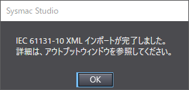

3. Sysmac Studioのタスク設定でプライマリ定周期タスクに以下のようにプログラムを割り付けます（マルチビューエクスプローラ|構成・設定|タスク設定|プログラムの割付設定|）。必要に応じて、デフォルトで作成されるProgram0プログラムを削除してください。特に、`JiecUnitMain`が先頭になるように設定してください。
  * `JiecUnitMain`
  * `test_mean`
  * `test_RunningMean`
  * `Mean_of_negative_values`
  * `RunningMeanFixture_follows_the_samples`

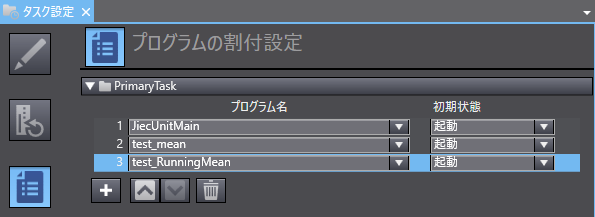

4. ビルド（F8キー）し、シミュレータ（F5キー）や実機で実行します。
5. テストの実行結果がグローバル変数`g_console`に出力されます。

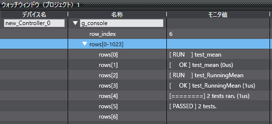

テストが実行され、テストをパス（成功）したことを意味します。（画面の写真は7.x のもので、テストが2つの時点の表示です。）

以下は、テストが失敗したときの例です。テスト`test_RunningMean`のテストコードの3サイクル目において、期待値は5であったが、実値は3となり、失敗したことを意味します。画面の写真は7.x の表示形式（`test_RunningMean:57@2`）です。7.0.0 より後の版では、`samples/sample.iec:47: Failure (cycle 2)` に続けて `Expected equality of these values:` と式・値を表示します（[失敗の出力](#失敗の出力)）。

※行番号は、XMLにコンバートする前のテキストの行番号です。これをSysmac Studio上のtest_RunningMeanの行数で表示するテクニックは、[Jieccソフトウェア](https://www.graviness.com/iec_61131-3/jiecc.html)の機能を活用します。ここでは、深く述べません。

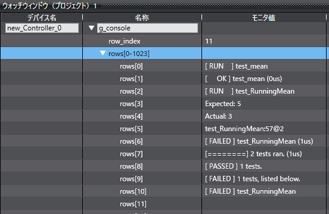

### キーエンス社製KV Studioの場合の単体テストサンプルの実行方法

1. コマンドプロンプトを起動し、次のコマンドを実行します。

コマンド内の`<JiecUnit Project Root>`はJiecUnitプロジェクトをダウンロードしたディレクトリに変更してください。また、事前にjiecc.exeを`<JiecUnit Project Root>`直下におくか、jieccがあるディレクトリへパスを通しておいてください。

```
$ cd <JiecUnit Project Root>
$ jiecc .\samples\sample.iec -I. -I.\sys -t keyence -o .\samples\sample.xml
```

`.\samples\sample.xml`が出力されます。

2. 出力された`.\samples\sample.xml`をKV StudioのIEC 61131-10インポート機能 \[ ファイル | インポート | IEC 61131-10 XMLのインポート \] でインポートします。

単体テストを実行するためのグローバル変数、データ型、およびPOUがインポートされます。インポート完了後に次のダイアログが表示されるので、OKを押下します。

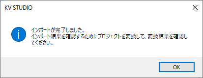

3. KV Studioのワークスペースにおいて、毎スキャンモジュールが次のようになっていることを確認します。必要に応じて、デフォルトで作成される`Main`モジュールを削除してください。特に`JiecUnitMain`が先頭になっていることを確認してください。
  * `JiecUnitMain`
  * `test_mean`
  * `test_RunningMean`
  * `Mean_of_negative_values`
  * `RunningMeanFixture_follows_the_samples`

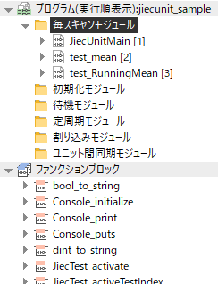

4. 変換（Ctrl＋F9キー）し、シミュレータ（Ctrl＋F2キー）や実機で実行（シミュレータの場合、[ デバッグ | RUN ]）します。
5. テストの実行結果がグローバル変数`g_console`に出力されます。

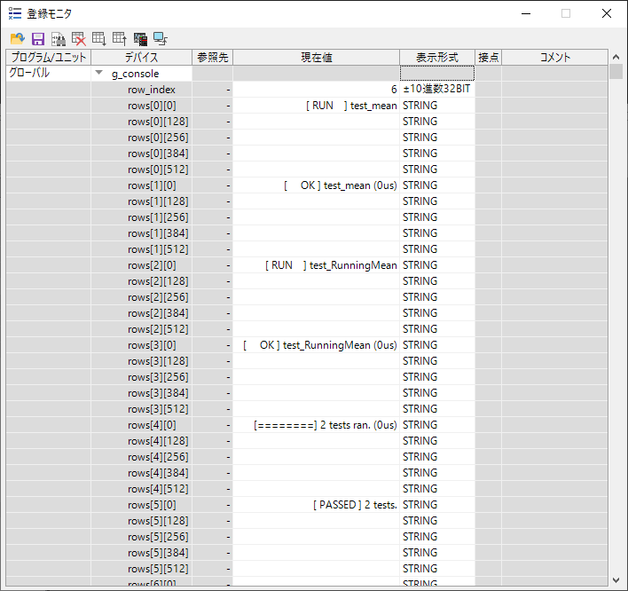

テストが実行され、テストをパス（成功）したことを意味します。（画面の写真は7.x のもので、テストが2つの時点の表示です。）

以下は、テストが失敗したときの例です。テスト`test_RunningMean`のテストコードの3サイクル目において、期待値は5であったが、実値は3となり、失敗したことを意味します。画面の写真は7.x の表示形式（`test_RunningMean:56@2`）です。7.0.0 より後の版では、`samples/sample.iec:47: Failure (cycle 2)` に続けて式・値を表示します（[失敗の出力](#失敗の出力)）。

※行番号は、XMLにコンバートする前のテキストの行番号です。これをKV Studio上のtest_RunningMeanの行数で表示するテクニックは、[Jieccソフトウェア](https://www.graviness.com/iec_61131-3/jiecc.html)の機能を活用します。ここでは、深く述べません。

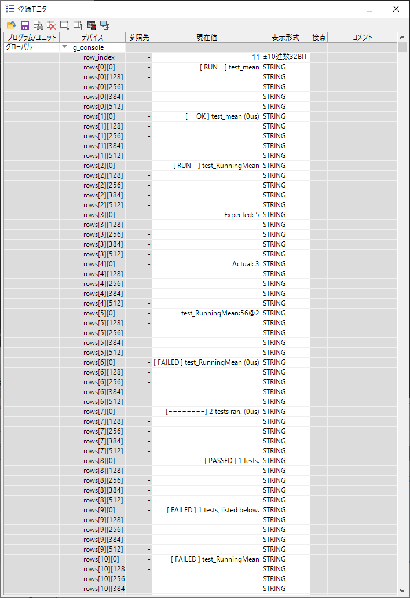

### CODESYS社製CODESYSの場合の単体テストサンプルの実行方法

事前にCODESYSの[IEC 61131-10のインポート機能を有効化](https://content.helpme-codesys.com/en/CODESYS%20Development%20System/_cds_cmd_import_iec_61131_10.html)しておいてください。

1. コマンドプロンプトを起動し、次のコマンドを実行します。

コマンド内の`<JiecUnit Project Root>`はJiecUnitプロジェクトをダウンロードしたディレクトリに変更してください。また、事前にjiecc.exeを`<JiecUnit Project Root>`直下におくか、jieccがあるディレクトリへパスを通しておいてください。

```
$ cd <JiecUnit Project Root>
$ jiecc .\samples\sample.iec -I. -I.\sys -t codesys -o .\samples\sample.xml
```

`.\samples\sample.xml`が出力されます。

2. CODESYSにてNew ProjectにてEmpty projectを作成し、出力された`.\samples\sample.xml`をCODESYSのIEC 61131-10インポート機能 \[File | Import IEC 61131-10\] でインポートします。

インポートダイアログが表示されます。

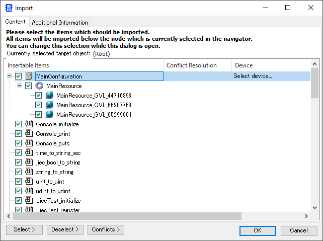

3. OKボタンを押下します。

単体テストを実行するためのコンフィグレーション、リソース、グローバル変数、データ型、POUがインポートされます。

4. CODESYSのDevices画面において、インポートされたMainConfigurationを右クリックし、Update Device...から適切なデバイスを設定します。

5. POUs画面において、以下画像の通りにオブジェクトを選択し（Project Settings以外を選択し）、Devices画面のMainResourceにドラッグ＆ドロップします。

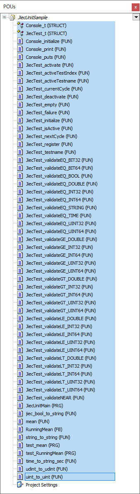

MainResouce下にオブジェクトが移動されます。

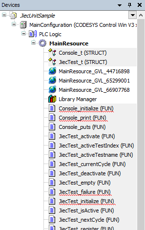

6. Devices画面において、MainResourceを右クリックし、Add Object | Task Configuration... し、追加されたTask Configurationを次のように設定します。特に`JiecUnitMain`が先頭になっていることを確認してください。
  * `JiecUnitMain`
  * `test_mean`
  * `test_RunningMean`
  * `Mean_of_negative_values`
  * `RunningMeanFixture_follows_the_samples`

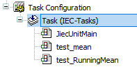

7. Devices画面のLibrary Managerを選択し、AddLibraryを選択し、次の画面のようにStandard Libraryの`CONCAT`を選択した状態にし、OKボタンを押下します。

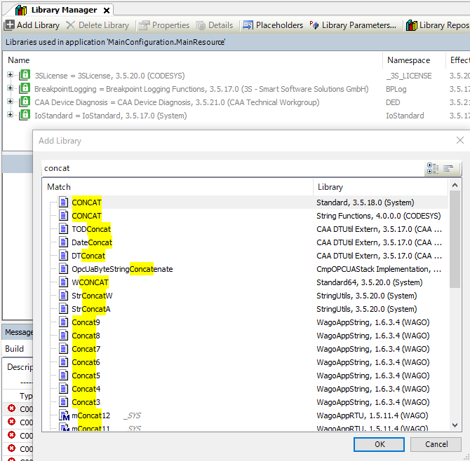

Standardライブラリが追加されます。

8. Generate Code（F11キー）すると、「C0174: VAR_TEMP declaration not allowed in this place」エラーが複数出力されますので、Replaceダイアログで次のように設定し、Replace Allボタンを押下します。

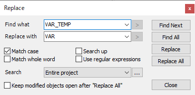

ソースコード内のすべての`VAR_TEMP`が`VAR`に置換されます。

9. Generate Code（F11キー）し、成功することを確認します。シミュレーションや実機で実行（シミュレーションの場合、[ Debug | F5 ]）します。

10. テストの実行結果がグローバル変数`g_console`に出力されます。

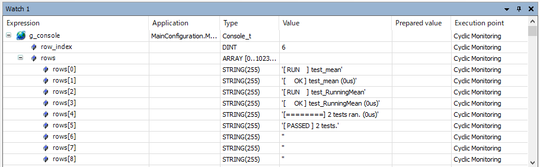

テストが実行され、テストをパス（成功）したことを意味します。（画面の写真は7.x のもので、テストが2つの時点の表示です。）

以下は、テストが失敗したときの例です。テスト`test_RunningMean`のテストコードの3サイクル目において、期待値は5.0であったが、実値は3.0となり、失敗したことを意味します。画面の写真は7.x の表示形式（`test_RunningMean:58@2`）です。7.0.0 より後の版では、`samples/sample.iec:47: Failure (cycle 2)` に続けて式・値を表示します（[失敗の出力](#失敗の出力)）。

※行番号は、XMLにコンバートする前のテキストの行番号です。これをCODESYS上のtest_RunningMeanの行数で表示するテクニックは、[Jieccソフトウェア](https://www.graviness.com/iec_61131-3/jiecc.html)の機能を活用します。ここでは、深く述べません。

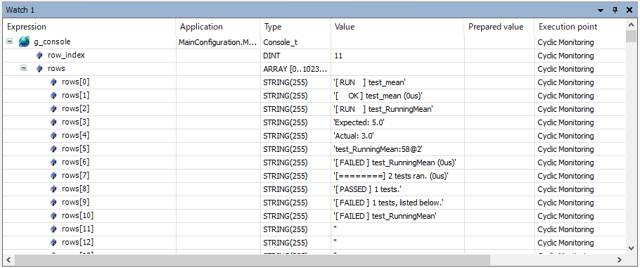

## JiecUnit開発者向け

### リポジトリ構成

* [jiecunit.iec](./jiecunit.iec)：JiecUnitユーザが使用すべき公開API。テスト記述用のマクロや関数群を定義。
* [docsディレクトリ](./docs/)：補助資料（各種画像、説明図、メーカー別手順、技術資料など）を格納。
* [samplesディレクトリ](./samples/)：JiecUnitの使い方サンプル。テスト対象POU（sample_pous.iec）とテストコード（sample.iec）を含む。
* [srcディレクトリ](./src/)：JiecUnit本体のソースコード。コア機能、テスト実行エンジン、設定ファイルなど。
* [sysディレクトリ](./sys/)：JiecUnitの動作に必要な補助的コード。型変換ファンクション、コンソール出力、メーカー依存の補助関数など。
* [testディレクトリ](./test/)：JiecUnit自体の単体テストコード。各種マクロ・内部関数の動作検証用テストファイル（test_jiectest.iec等）を含む。[test/golden](./test/golden/)には、失敗の出力やランナーの挙動（スキップ、タイムアウト、フィクスチャ、再実行など）を、期待する出力（`.out`）と比べるケースを置く。
* [scriptsディレクトリ](./scripts/)：開発補助スクリプト。マクロ生成（generate_macros.py）、テスト一括実行（run_tests.py）、メッセージ引数省略形と`_MSG`形の展開結果一致・式のテキストの検証（check_macro_expansion.py）、ゴールデン出力の比較（check_golden.py）、JUnit XMLへの変換（jiecunit_to_junit.py）を含む。
* [checkディレクトリ](./check/)：テスト結果（XMLファイル等）の出力先。テスト実行時に生成される成果物を格納。
* [README.md](./README.md)：本ドキュメント。使い方・構成・サポート状況などを記載。
* [AGENTS.md](./AGENTS.md)：生成AI（AIエージェント）向けのリポジトリ運用ルール。CLAUDE.mdは、これを取り込むだけのファイル。
* [CONTRIBUTING.md](./CONTRIBUTING.md)：貢献の流れ、コーディング規約（命名規則・フォーマット・テストの書き方など）、バージョン管理の運用ルール。
* [CHANGELOG.md](./CHANGELOG.md)：変更履歴。
* [SECURITY.md](./SECURITY.md)：セキュリティポリシー。脆弱性の報告方法。
* [.githubディレクトリ](./.github/)：GitHub Actionsの設定（workflows/ci.yml）とDependabotの設定。CIのテストジョブはWindows（jiecc.zip）とLinux（jiecc.tgz）の両方で実行し、それぞれ、全スイートのコンパイル（`run_tests.py --compile-only`）とマクロ展開の一致検証（`check_macro_expansion.py`）を必須とし、jier（`jiecc --run`）によるテスト実行とゴールデン出力の比較は任意とする（失敗しても警告として表示し、ワークフローは失敗させない）。
* [LICENSE](./LICENSE)：ライセンス情報。
* [VERSION](./VERSION)：バージョン管理用ファイル。

### JiecUnitのテスト方法

まず、以下のコマンドで一括検証することを推奨します（全ターゲットのコンパイル確認、jierインタプリタによるテスト実行、メッセージ引数省略形と`_MSG`形の展開結果一致検証、およびゴールデン出力の比較を一度に行います）。

```
$ cd <JiecUnit Project Root>
$ python scripts/run_tests.py
```

* コンパイルは最大4本の`jiecc`を同時に実行します（`--jobs N`で1〜4を指定。既定は4）。jierによる実行とマクロ展開の検証は1本ずつ実行します。
* コンパイルと実行の`jiecc`には`-Werror`と`-Wundef`を付けます。警告が1件でも出ると失敗になります。

マクロ展開の同値検証だけを単独で実行したい場合は、以下のコマンドを使用します。

```
$ python scripts/check_macro_expansion.py
```

ゴールデン出力の比較だけを実行する場合は、以下のコマンドを使用します。出力の形式を変えたときは`--update`で期待値を作り直し、差分（`git diff test/golden`）を確認してからコミットします。

```
$ python scripts/check_golden.py
$ python scripts/check_golden.py --update test/golden/failure_formats.iec
```

個別にjierインタプリタで実行する場合は、以下のコマンドを使用します。

```
$ jiecc --run test/test.iec -I. -I./sys --max-cycles 100000
```

* `jiecc --run`は、`JiecUnitMain`が集計を表示した時点で`halt`を呼んでスキャンを止め、プロセスの終了コードがテスト結果を反映します（全テスト合格なら0、失敗があるか登録時の致命的エラーなら1）。`scripts/run_tests.py`は標準出力の`[ PASSED ]`/`[ FAILED ]`行で判定し、加えて終了コードが0以外なら失敗とします。
* `--max-cycles`オプションは、集計後に自分で止まるため必須ではありませんが、テストが終わらない場合の上限として付けておくことを勧めます。

ベンダIDEへの取り込みを確認する場合は、ターゲットの環境ごとに以下のコマンドを実行し、上述と同じ手順を実行します。

```
$ cd <JiecUnit Project Root>
$ mkdir check
$ cd check
$ jiecc -I.. -I..\sys ..\test\test.iec -o .\test.xml -t omron
or
$ jiecc -I.. -I..\sys ..\test\test.iec -o .\test.xml -t keyence
or
$ jiecc -I.. -I..\sys ..\test\test.iec -o .\test.xml -t codesys
```

### ターゲットごとのアサーションの対応

✓はjieccの変換とjierの実行で確認したもの、―は使えないもの（前処理のエラーか未定義のマクロになる）です。MITSUBISHIは変換だけを確認しており、動作は保証しません。7.0.0 より後に追加した機能（`*_FLOAT_EQ`/`*_DOUBLE_EQ`、配列、部分文字列、フィクスチャ、ヘルパー、結果の変数）は、OMRON の Sysmac Studio で、サンプル（`samples/sample.iec`。スイートとフィクスチャのテストを含む）の取り込み・ビルド・実行と、所要時間の表示を確認しました（2026-11-10）。サンプルが使っていないアサーション（配列、部分文字列、`SCOPED_TRACE` など）と、KV Studio・CODESYS への取り込みとビルドは確認していません。

| アサーション | OMRON | KEYENCE | CODESYS | MITSUBISHI | jier |
|---|:-:|:-:|:-:|:-:|:-:|
| `EQ`/`NE`/`LT`/`LE`/`GE`/`GT` の 32bit 以下の整数・ビット列、`REAL`/`LREAL`、`BOOL`、`STRING` | ✓ | ✓ | ✓ | ✓ | ✓ |
| 同上の 64bit の型（`LINT`/`ULINT`/`LWORD`/`INT64`/`UINT64`/`BIT64`） | ✓ | ― | ✓ | ― | ✓ |
| `EQ_TIME`/`NE_TIME` | ✓ | ― | ✓ | ― | ✓ |
| `LT_TIME`/`LE_TIME`/`GE_TIME`/`GT_TIME` | ✓ | ✓ | ✓ | ― | ✓ |
| `DATE`/`TOD`/`DT` | ✓ | ― | ✓ | ― | ✓ |
| `NEAR`/`NEAR_REL`/`DOUBLE_EQ`/`FLOAT_EQ`、`EQ_ARRAY_<T>`（`<T>` の対応は上と同じ）、`STR_CONTAINS` | ✓ | ✓ | ✓ | ✓ | ✓ |
| 所要時間の表示 | ✓ | ✓ | `(n/a)` | `(n/a)` | `(n/a)` |

### 各メーカーのIEC 61131-3言語サポート状況

| 項目             | OM (Sysmac) | KE (KV) | CO (CODESYS) |
|------------------|:-----------:|:-------:|:------------:|
| データ型 SINT    | ✓           |         | ✓            |
| データ型 INT     | ✓           | ✓       | ✓            |
| データ型 DINT    | ✓           | ✓       | ✓            |
| データ型 LINT    | ✓           |         | ✓            |
| データ型 USINT   | ✓           |         | ✓            |
| データ型 UINT    | ✓           | ✓       | ✓            |
| データ型 UDINT   | ✓           | ✓       | ✓            |
| データ型 ULINT   | ✓           |         | ✓            |
| データ型 REAL    | ✓           | ✓       | ✓            |
| データ型 LREAL   | ✓           | ✓       | ✓            |
| データ型 BYTE    | ✓           |         | ✓            |
| データ型 WORD    | ✓           |         | ✓            |
| データ型 DWORD   | ✓           |         | ✓            |
| データ型 LWORD   | ✓           |         | ✓            |
| データ型 TIME    | ✓           |         | ✓            |
| データ型 BOOL    | ✓           | ✓       | ✓            |
| データ型 DATE    | ✓           |         | ✓            |
| データ型 TIME_OF_DAY    | ✓           |         | ✓            |
| データ型 DATE_AND_TIME    | ✓           |         | ✓            |
| データ型 STRING  | ✓           | ✓       | ✓            |
| データ型 WSTRING |             |         | ✓            |
| 構造体          | ✓           | ✓       | ✓            |
| FB              | ✓           | ✓       | ✓            |
| 配列            | ✓           | ✓       | ✓            |

## ライセンス

このプロジェクトはMIT Licenseのもとで公開されています。詳細は[LICENSE](./LICENSE)ファイルをご参照ください。

## その他の情報

[Graviness Blog](http://blog.graviness.com/?eid=949303)もご参照ください。
